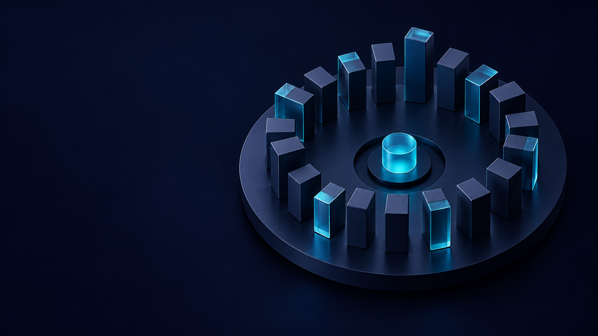
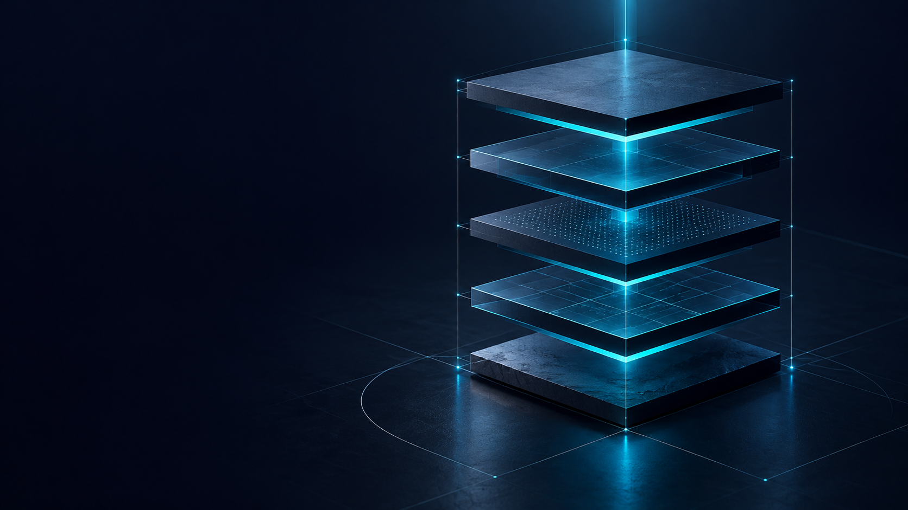
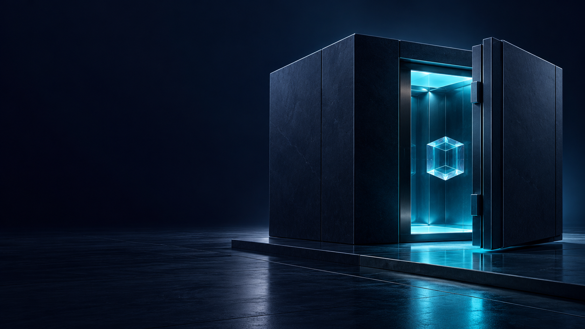
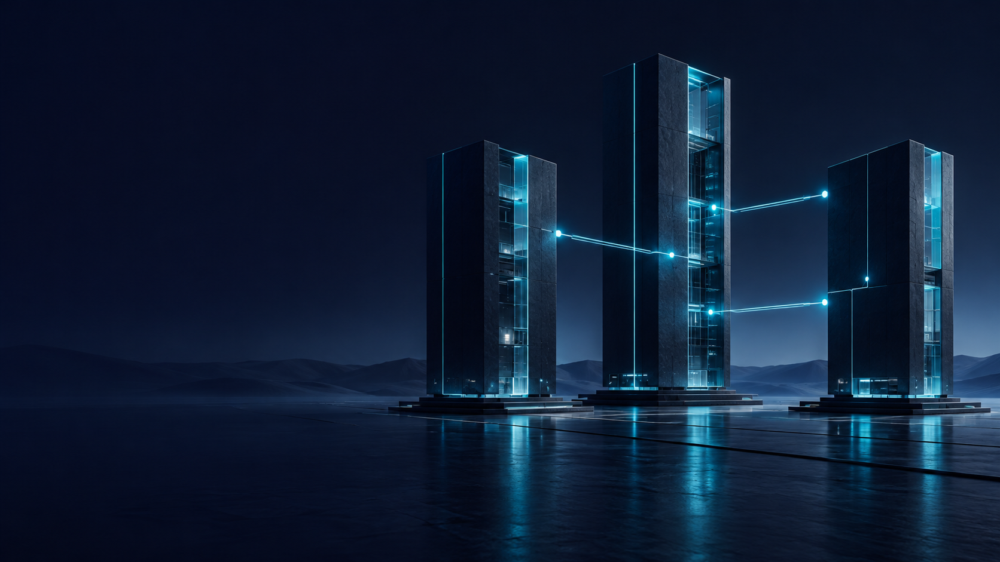

# TBCi — брендбук v2.1

30 октября 2026. Выбранный логотип: №7 / Signal. Дополнение: 30 тематических иконок к 16 интерфейсным; всего 46. Все страницы визуального PDF переработаны.

[PDF](TBCI-Brandbook.pdf) · [Каталог активов](assets.html) · [Документация сервиса](../SERVICE.html)

## 01 / Система — Brandbook

Версия 2.1 от 30 октября 2026. Пользователь выбрал направление логотипа №7. К существующему набору из 16 интерфейсных иконок добавлены 30 тематических. Переработаны все страницы визуального брендбука.

## 02 / Смысл — Сложный рынок. Ясная структура.

Предлагаемая платформа бренда; функциональная основа — предоставленные материалы.

Наблюдать. Индекс помогает видеть динамику выбранной корзины рынка.

Понимать. Состав, методология и источники делают показатели объяснимыми.

Действовать осознанно. Цена, комиссия и результат операции видны до подтверждения.

## 03 / Характер — Один сигнал. Три опоры.

Чистая геометрия в идентичности; выразительные изображения — в коммуникации.

Точность: Прямые сегменты. Ровный штрих. Отчётливые числовые единицы.

Прозрачность: Спокойные панели. Понятные подписи. Видимый источник данных.

Сдержанность: Тёмная основа. Один циановый акцент. Свечение только в иллюстрации.

## 04 / Логотип — TBCi / Signal 07

Выбранное направление №7 переведено в вектор и нормализовано для использования.

Знак: Три сегмента. Единая толщина. Углы 45°.

Написание: TBC — прописные; i — строчная с бирюзовой точкой.

Мастер: SVG с буквами в контурах. Шрифт устанавливать не нужно.

Основной и светлый логотипы имеют бирюзовую точку над i. Ствол i и другие буквы не изменены. Одноцветные варианты остаются одноцветными.

Словесная часть нормализованного мастера выполнена Open Sans Bold. Это новый векторный мастер выбранного направления, а не восстановление неизвестного шрифта растровой генерации.

## 05 / Варианты — На тёмном. На светлом. В один цвет.

Использовать готовые файлы, сохраняя знак, пропорции и расстояние до названия.

Основной / cyan + ice

На светлом / deep + ocean

Одноцветный / белый

Одноцветный / тёмный

## 06 / Построение — Пространство вокруг знака

Охранное поле и минимальный размер относятся к видимой композиции, а не только к границе файла.

Поле: не меньше x со всех сторон.

Знак: от 24 px по ширине.

Композиция: от 120 px; для хедера рекомендуется 160 px.

В печати: от 30 мм.

Не менять наклон, толщину, пропорции и интервал. Не добавлять тень или свечение.

## 07 / Палитра — Ночь. Глубина. Сигнал.

Нормализованный стандарт sRGB, сформированный по визуальному направлению мудборда.

Void #070A22

Deep #102441

Ocean #0B3559

Signal #00CDEB

ice #F2F7FB

mist #A8BBD2

up #35D36A

down #FF6B7A

warning #FFC76A

## 08 / Типографика — Типографика без шума

Open Sans: Regular — текст и крупные заголовки; Semibold — акценты; Bold — логотип.

Web-шкала: начертания Regular 400 и Semibold 600, без Light. H1 48/56 px (мобильный 32/40); H2 32/40; H3 24/32; основной текст 16/24; подпись 14/20; микроподпись 12/16. Для чисел — табличные цифры. В заголовках не использовать избыточный верхний регистр.

## 09 / Сетка — Сетка держит композицию

Базовый модуль 8 px. Контент до 1200 px. Поля от 16 px.

12 колонок: от 1024 px / gap 24 px

8 колонок: 768–1023 px / gap 16 px

4 колонки: до 768 px / gap 16 px

Ступени отступов: 8, 16, 24, 32, 48, 64, 96 px. Карточки: поля 24 px на широком и 16 px на узком экране.

## 10 / Графика — Геометрия в основе. Свет в акценте.

Сеть: Тонкие связи и редкие узлы по краям композиции.

Грань: Крупные плоскости и ясные направления.

Свет: Фокус на одном объекте, не на каждом элементе.

## 11 / Интерфейс — Компоненты, которые помогают действовать

Меньше декоративных эффектов в рабочем кабинете. Чёткие состояния и понятные глаголы.

Состояния: default, hover, pressed, focus, disabled, loading, success, error. Primary: Signal с тёмным текстом; hover #36DDF2, pressed #00B5D0. Focus: 2 px Ice с отступом 3 px. Поле всегда имеет подпись.

## 12 / Данные — Данные важнее впечатления

Учебный ряд для оформления. Не котировка и не обещание доходности.

Показывать источник, период, единицы и время обновления. Пункты индекса не равны цене токена или балансу. Рост/падение различаются знаком, подписью и цветом. У графика нужны текстовые значения и управление с клавиатуры.

## 13 / Иконки — Интерфейсный набор / 16

SVG + прозрачный PNG. Сетка 24 × 24 px; штрих 1,75 px; единый цвет через currentColor.

Иконки: Индекс, Кошелёк, Корзина, Купить, Продать, Собрать, Разобрать, История, Держатели, Защита, API, Методология, Ребалансировка, Новости, Поиск, Настройки.

SVG-иконки: сетка 24 px, штрих 1,75 px; рекомендуемые размеры 24 и 32 px. Для 16 px нужна оптическая адаптация. У иконки действия есть подпись или доступное имя; область нажатия минимум 44 × 44 px. В таблицах иконки не подменяют финансовые значения.

## 14 / Иконки — Тематический набор / 01–15

SVG + прозрачный PNG. Сетка 24 × 24 px; штрих 1,75 px; единый цвет через currentColor.

Иконки: Аналитика, Свечи, Распределение, Доли, Доходность, Волатильность, Сравнение, Калькулятор, Формула, Капитализация, Ликвидность, Стакан, Биржа, Обмен, Пополнение.

SVG-иконки: сетка 24 px, штрих 1,75 px; рекомендуемые размеры 24 и 32 px. Для 16 px нужна оптическая адаптация. У иконки действия есть подпись или доступное имя; область нажатия минимум 44 × 44 px. В таблицах иконки не подменяют финансовые значения.

## 15 / Иконки — Тематический набор / 16–30

SVG + прозрачный PNG. Сетка 24 × 24 px; штрих 1,75 px; единый цвет через currentColor.

Иконки: Вывод, Перевод, Ожидание, Квитанция, Комиссии, Сетевая комиссия, Токен, Блокчейн, Смарт-контракт, Мультиподпись, Ключ доступа, Идентификация, Уведомления, Глобальный рынок, Поддержка.

SVG-иконки: сетка 24 px, штрих 1,75 px; рекомендуемые размеры 24 и 32 px. Для 16 px нужна оптическая адаптация. У иконки действия есть подпись или доступное имя; область нажатия минимум 44 × 44 px. В таблицах иконки не подменяют финансовые значения.

## 16 / Фоны — Горизонт сигнала

Первый экран, разделитель, обложка. Текст — в верхней половине.

Фон bg-01-signal-horizon. Формат PNG 1672 × 941 px. Сохранять пропорции; не растягивать. При размещении текста проверять контраст итоговой композиции. В плотных таблицах использовать сплошную панель.

## 17 / Фоны — Поле связей

API, партнёры, подписка. Основной текст — слева.

Фон bg-02-network-field. Формат PNG 1672 × 941 px. Сохранять пропорции; не растягивать. При размещении текста проверять контраст итоговой композиции. В плотных таблицах использовать сплошную панель.

## 18 / Фоны — Полигональный ландшафт

Методология и обзор рынка. Текст — в верхних двух третях.

Фон bg-03-faceted-terrain. Формат PNG 1672 × 941 px. Сохранять пропорции; не растягивать. При размещении текста проверять контраст итоговой композиции. В плотных таблицах использовать сплошную панель.

## 19 / Иллюстрации — Иллюстрации / смысл продукта

Шесть самостоятельных изображений. Общая палитра и материалы; разные сюжеты.

Рыночный сигнал — illustrations/art-01-market-signal.png

Корзина активов — illustrations/art-02-balanced-basket.png

Методология — illustrations/art-03-methodology.png

Каждый файл PNG 1672 × 941 px. Изображения без текста и логотипа; подписи, факты и даты накладываются отдельно в макете. Художественное количество объектов и их размеры не являются данными.

## 20 / Иллюстрации — Иллюстрации / операции и инфраструктура

Шесть самостоятельных изображений. Общая палитра и материалы; разные сюжеты.

Хранение — illustrations/art-04-secure-custody.png

Ребалансировка — illustrations/art-05-rebalancing.png

Связанные данные — illustrations/art-06-connected-data.png

Каждый файл PNG 1672 × 941 px. Изображения без текста и логотипа; подписи, факты и даты накладываются отдельно в макете. Художественное количество объектов и их размеры не являются данными.

## 21 / Применение — Главная: смысл, показатель, действие

Пример визуальной композиции. Все значения учебные; это не работающий сервис.

Пример главной страницы: новый логотип, фон Network field, понятное описание, индекс в пунктах и один главный призыв «Изучить индекс». Декоративная сеть отделена от зоны данных.

## 22 / Применение — Одна система на разных носителях

Изображение поддерживает сообщение; знак остаётся плоским и читаемым.

Носители: обложка 1200 × 630 px, квадрат 1080 × 1080 px, презентация 16:9. Поле безопасности — 8% от меньшей стороны. Логотип накладывается отдельным векторным слоем. Не добавлять обещаний гарантированного роста или доходности.

## 23 / Доступность — Понятно читать. Легко проверить.

Ясный язык, контраст и полные значения — часть фирменного стиля.

Основной текст: от 4,5:1. Контрольные элементы и крупный текст: от 3:1.

Изменение обозначать знаком и текстом; одна окраска недостаточна.

Показывать единицу, период и часовой пояс. Полная сумма доступна по раскрытию или копированию.

Говорить предметно: «Не хватает 0,012 ETH» вместо общей ошибки. Учитывать reduced motion.

Предлагаемый RU-вывод: 12 000,00 USD; 0,833333333 TBCi; −3,72%. EN: 12,000.00 USD; 0.833333333 TBCi; −3.72%. Историческое ТЗ требует точку: изменение локализации нужно согласовать при реализации. Декоративные переходы 160–240 мс, отключение по prefers-reduced-motion.

## 24 / Комплект — Готово к последовательному применению

Логотип №7 выбран пользователем. Дополнительные правила систематизированы в этой версии.

Комплект: PDF, Word, Markdown, HTML-каталог assets.html, logo/, icons/, backgrounds/, illustrations/, tokens.json, theme.css и generated-assets.json. Приватные данные не используются. Старые макеты и мудборд остаются историческими источниками; старый знак заменён новым в действующих правилах.

## Правила файлов

### Логотип

[Основной SVG](logo/tbci-logo-primary.svg) · [Прозрачный PNG](logo/tbci-logo-primary.png) · [Векторный PDF](logo/tbci-logo-primary.pdf)

Основной SVG: знак и точка i — #00CDEB, буквы — #F2F7FB. Для светлого фона — знак #0B3559, буквы #102441, точка i #00CDEB. В одноцветных версиях все элементы сохраняют один цвет. Одноцветные варианты — #FFFFFF или #102441. Векторный мастер — нормализация выбранного пользователем направления №7. Open Sans Bold встроен в форму букв как контуры; живого текста в SVG нет.

### Иконки

Исходные SVG используют currentColor и начальный цвет #00CDEB. При встраивании inline менять color через CSS; для отдельного img при необходимости подготовить файл с нужным цветом. Не применять opacity для обозначения важного статуса без подписи.

[Все 46 иконок — sprite](icons/tbci-all-icons-sprite.svg) · [Реестр](icons/all-icons-register.json)

Интерфейсные 16 и новые тематические 30 — разные наборы. Полный список:

- [Индекс](icons/index.svg) — index
- [Кошелёк](icons/wallet.svg) — wallet
- [Корзина](icons/basket.svg) — basket
- [Купить](icons/buy.svg) — buy
- [Продать](icons/sell.svg) — sell
- [Собрать](icons/compile.svg) — compile
- [Разобрать](icons/unmake.svg) — unmake
- [История](icons/history.svg) — history
- [Держатели](icons/holders.svg) — holders
- [Защита](icons/security.svg) — security
- [API](icons/api.svg) — api
- [Методология](icons/methodology.svg) — methodology
- [Ребалансировка](icons/rebalance.svg) — rebalance
- [Новости](icons/news.svg) — news
- [Поиск](icons/search.svg) — search
- [Настройки](icons/settings.svg) — settings
- [Аналитика](icons/thematic/analytics.svg) — analytics
- [Свечи](icons/thematic/candlestick.svg) — candlestick
- [Распределение](icons/thematic/allocation.svg) — allocation
- [Доли](icons/thematic/pie-chart.svg) — pie-chart
- [Доходность](icons/thematic/performance.svg) — performance
- [Волатильность](icons/thematic/volatility.svg) — volatility
- [Сравнение](icons/thematic/comparison.svg) — comparison
- [Калькулятор](icons/thematic/calculator.svg) — calculator
- [Формула](icons/thematic/formula.svg) — formula
- [Капитализация](icons/thematic/market-cap.svg) — market-cap
- [Ликвидность](icons/thematic/liquidity.svg) — liquidity
- [Стакан](icons/thematic/order-book.svg) — order-book
- [Биржа](icons/thematic/exchange.svg) — exchange
- [Обмен](icons/thematic/swap.svg) — swap
- [Пополнение](icons/thematic/deposit.svg) — deposit
- [Вывод](icons/thematic/withdraw.svg) — withdraw
- [Перевод](icons/thematic/network-transfer.svg) — network-transfer
- [Ожидание](icons/thematic/pending.svg) — pending
- [Квитанция](icons/thematic/receipt.svg) — receipt
- [Комиссии](icons/thematic/fees.svg) — fees
- [Сетевая комиссия](icons/thematic/gas.svg) — gas
- [Токен](icons/thematic/token.svg) — token
- [Блокчейн](icons/thematic/blockchain.svg) — blockchain
- [Смарт-контракт](icons/thematic/smart-contract.svg) — smart-contract
- [Мультиподпись](icons/thematic/multisig.svg) — multisig
- [Ключ доступа](icons/thematic/access-key.svg) — access-key
- [Идентификация](icons/thematic/identity.svg) — identity
- [Уведомления](icons/thematic/notification.svg) — notification
- [Глобальный рынок](icons/thematic/global-market.svg) — global-market
- [Поддержка](icons/thematic/support.svg) — support

### Изображения и фоны

Файлы сохранены в исходном разрешении генерации: 1672 × 941 px. Не обозначать их как 4K. Использовать с сохранением пропорций; для крупной печати оценить разрешение на финальном размере. Это не бесшовные текстуры.

[Реестр изображений](generated-assets.json)

### bg-01-signal-horizon

### bg-02-network-field

### bg-03-faceted-terrain

### art-01-market-signal

### art-02-balanced-basket

### art-03-methodology

### art-04-secure-custody

### art-05-rebalancing

### art-06-connected-data

## Технические параметры

| Токен | sRGB HEX |
|---|---|
| void | #070A22 |
| deep | #102441 |
| ocean | #0B3559 |
| signal | #00CDEB |
| ice | #F2F7FB |
| mist | #A8BBD2 |
| up | #35D36A |
| down | #FF6B7A |
| warning | #FFC76A |

Контент до 1200 px; базовый модуль 8 px. Брейкпоинты: 768 и 1024 px. Сетка 4/8/12 колонок, gap 16/16/24 px. Контролы 48 px, радиус 8 px. Минимальная область нажатия 44 × 44 px. Граница focus 2 px с отступом 3 px.

Лицензии Open Sans и DejaVu приложены. Новые картинки сгенерированы для этого проекта; старые сторонние изображения из архивов не становятся собственными активами от включения в документацию.

## Подключение Open Sans

Для HTML Open Sans подключён локально через @font-face в theme.css. Комплект содержит TTF 400/600/700 и лицензию; внешний CDN не нужен. В PDF шрифты встроены. В Word задан Open Sans; для одинакового отображения установите приложенные TTF. Light 300 больше не используется.

## Источники и статус

Архив «Новый концепт Лысенко.rar» задаёт палитру и атмосферу. Исторический треугольный логотип заменён по просьбе пользователя. Пользователь выбрал новый вариант №7 из предложенных картинок. Остальные логотипы не входят в действующий набор. Новый графический комплект не подтверждает наличие работающего финансового сервиса, актуальных контрактов или реальных рыночных данных.
