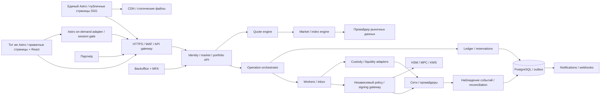
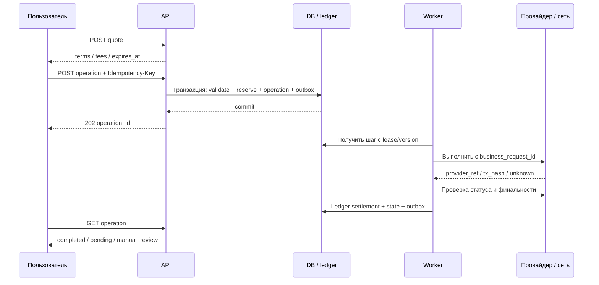
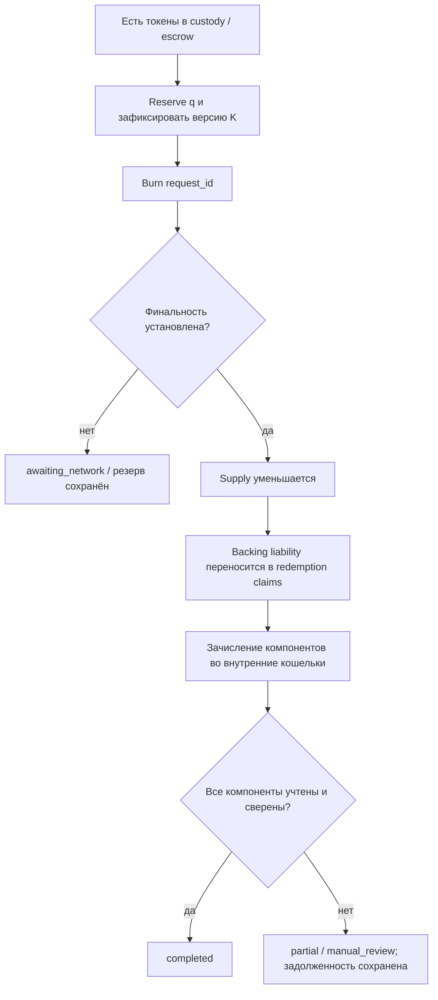

# TBCi — архитектурные схемы

Приложение к ТЗ v1.1. Схемы задают базовый дизайн, а не текущую инфраструктуру.

## 1. Модули и границы доверия

Signing-контур — отдельная граница доверия. Он не принимает произвольные методы/назначения от API без проверки. Постоянный финансовый журнал находится в PostgreSQL; Redis и очереди не являются единственным источником балансов или финансовых намерений.

## 2. Принятие операции

Если требуется MFA и подтверждение не передано, операция создаётся в awaiting_approval без резерва. После challenge/confirm заново проверяются quote TTL, право и ресурсы; только затем выполняется транзакция резервирования.

## 3. Погашение и сохранение обязательств

Непогашенные claims не превращаются в свободный резерв. Внешний вывод компонентов — отдельная операция. Диаграмма не обещает атомарного завершения нескольких блокчейнов.

## 4. Ребалансировка

Draft → расчёт состава/затрат → независимое одобрение → планирование → остановка новых Compile/Unmake → завершение/урегулирование старых операций → реальное перемещение обеспечения → сверка → активация K и делителя → публикация истории → возобновление. При неопределённом обеспечении новая версия не активируется.

## 5. Фронтенд

Публичная часть: Astro + TypeScript, SSG, React-островки для графиков и интерактива. Кабинет: приватные страницы того же Astro-проекта под /app, on-demand session gate и интерактивные React-компоненты. Отдельного SPA/Vite-проекта нет. Backend: NestJS, отдельный API/worker-контур. Текущие данные приходят из API без пересборки статики. Общие UI/tokens/api-client пакеты; Next.js не используется; приватные маршруты обслуживает on-demand адаптер Astro, а финансовую логику — NestJS API.
