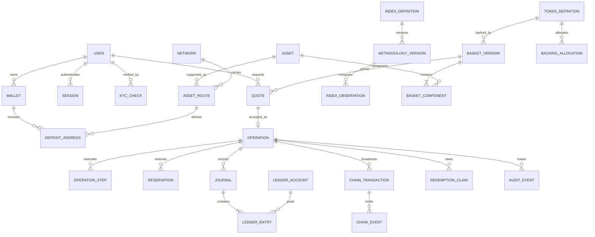

# TBCi — логическая модель данных

Приложение к ТЗ v1.1. Это проект схемы, а не существующие таблицы. Имена SQL адаптируются к выбранному стеку без изменения инвариантов.

## 1. Конвенции

UUID как primary key; время timestamptz UTC; суммы минимальных единиц NUMERIC(78,0), неотрицательные там, где требуется; цены decimal с явно выбранной точностью. Состояния — enum/справочник с валидируемыми переходами. Валюты не смешиваются в одной сумме. Число знаков хранится в версии AssetRoute, а не выводится из тикера.

## 2. Основные связи

Диаграмма концептуальная: M:N связи раскладываются в link tables. BasketVersion токена ссылается на версию индексной методики, но индекс и обеспечение не становятся одной таблицей или одним числом.

## 3. Детализация критических записей

| Таблица | Обязательные поля | Ограничения и индексы |
|---|---|---|
| users | id, email_norm, status, locale, timezone, created_at | UNIQUE(email_norm); индекс status/created_at; удаление по retention policy |
| sessions | id, user_id, token_hash, expires_at, revoked_at, device_label | UNIQUE(token_hash); каскадный отзыв, raw session token не хранить |
| credentials | user_id, password_hash, mfa_secret_ref, security_version | Приложение не хранит TOTP секрет открытым текстом |
| kyc_checks | id, user_id, provider_id/ref, state, valid_until, updated_at | UNIQUE(provider_id, provider_ref); inbox-dedup callback |
| assets | id, canonical_name, symbol, status | Тикер индексируется, но не уникален |
| networks | id, namespace, chain_id, finality_policy_version | UNIQUE(namespace, chain_id); конфигурация read-only после публикации |
| asset_routes | id, asset_id, network_id, contract_or_native_id, decimals, status, min/max_units | UNIQUE(network_id, contract_or_native_id, version); versioned routes |
| wallets | id, user_id, asset_id, asset_route_id, status | UNIQUE(user_id, asset_route_id, account_namespace); балансы сетей не смешиваются |
| deposit_addresses | id, wallet_id, route_id, address, memo, provider_ref | UNIQUE(route_id, address, normalized_memo); исключить коллизии назначения |
| methodology_versions | id, index_id, state, base_at, base_value, criteria_json, effective_range, source_policy | Запрет пересекающихся active intervals; immutable published rows |
| basket_versions | id, token_id, methodology_version_id, state, effective_at, proposed_by, approval_ref | Уникальная активная версия на момент; нельзя изменить K active version |
| basket_components | basket_version_id, asset_id, units_per_token_decimal, start_weight, price_snapshot_ref | UNIQUE(version, asset); сумма весов валидируется при approve |
| price_observations | id, asset_id, provider, observed_at, received_at, price, circulating_supply, quality, revision | UNIQUE(asset, provider, observed_at, revision); partition по времени |
| index_observations | index_id, methodology_version_id, timestamp, value, divisor, input_snapshot_ref, revision | UNIQUE(index, version, timestamp, revision); published revision явен |
| token_definitions | id, network_id, contract, decimals, symbol, policy_version, issuance_address | UNIQUE(network_id, contract); mainnet отдельно от testnet |
| quotes | id, actor_id/type, kind, token_id, basket_version_id, terms_json, terms_hash, expires_at, accepted_operation_id | UNIQUE(accepted_operation_id); неизменяемые terms; index actor/created_at |
| operations | id, actor_id/type, type, quote_id, state, version, created_at, completed_at, correlation_id | UNIQUE(quote_id) для quote flows; optimistic version; index actor/time и state/time |
| operation_steps | id, operation_id, kind, business_request_id, state, attempt, provider_ref, next_retry_at | UNIQUE(kind, business_request_id); lease/version worker |
| reservations | id, operation_id, account_id, amount_units, state, released_by_journal_id | Неотрицательные units; unique logical reservation; нет удаления активного резерва |
| ledger_accounts | id, asset_id, asset_route_id, owner_kind/id, category, status | UNIQUE(asset_route, owner_kind/id, category, namespace); без свободного mixing активов |
| journals | id, operation_id, cause_kind/id, state, reversal_of, created_at | UNIQUE(cause_kind, cause_id); immutable posted; ссылки на обратный journal |
| ledger_entries | id, journal_id, account_id, asset_id, direction, amount_units | >0; согласованность asset account/entry; deferred проверка баланса journal/asset |
| balance_projections | account_id, debit_units, credit_units, revision, rebuilt_at | Производная таблица; не первичный финансовый журнал |
| chain_transactions | id, network_id, operation_step_id, hash, sender, nonce, state, block_hash/height | UNIQUE(network, hash); nonce reservation уникальна по sender/network/nonce |
| chain_events | id, network_id, tx_hash, event_or_output_index, block_hash, observed_state | UNIQUE(network, tx_hash, event_or_output_index, logical_event_kind) |
| backing_allocations | id, token_id, basket_version_id, asset_id, allocated_units, state, source_journal_id | Только ссылки на подтверждённые ресурсы; обновления через ledger/операцию |
| redemption_claims | id, redemption_operation_id, asset_id, gross_units, fee_units, net_units, settled_units, state | 0 ≤ settled ≤ net; UNIQUE(operation, asset); закрытие только при полном settlement |
| reconciliations | id, scope, cutoff_at, source_snapshot_refs, result, freshness, created_at | Immutable run; отдельные discrepancy rows по активам |
| approvals | id, entity_kind/id, proposed_by, approved_by, decision, terms_hash, decided_at | proposer != approver; решение относится к конкретному хешу версии |
| idempotency_records | actor, route, key, request_hash, response_status/body_ref, operation_id, expires_at | UNIQUE(actor, route, key); payload mismatch → 409 |
| inbox / outbox | event_id, schema_version, payload_ref, aggregate/version, process/delivery state | Unique event_id; commit outbox вместе с бизнес-транзакцией |
| audit_events | id, actor, role, action, entity, reason, before/after_ref, request_id, occurred_at | Append-only; ограниченный доступ; экспорт и retention отдельно от debug logs |

## 4. Инварианты и атомарные границы

- Сумма дебетов и кредитов равна по каждому asset в posted journal. Создание всех entries и перевод journal в posted выполняются одной транзакцией.
- Принятие quote, создание operation и нужных reservations атомарно; при awaiting_approval финансовых эффектов ещё нет. Подтверждение заново проверяет срок и допуски.
- Ни UI, ни кеш, ни текущий balance snapshot не могут единолично изменить available balance.
- Сторно сохраняет ссылку на исходную запись; повтор source event не создаёт второй сторно/journal.
- Внешний бизнес-effect сохраняет request_id независимо от срока idempotency cache.
- Изменение basket K атомарно активируется только после фактического обеспечения и обработки pending operations.
- Supply, backing, client balances и redemption claims сверяются на согласованный cutoff с учётом pending chain finality. Одно событие не попадает одновременно в final и pending totals.
- Все таблицы с пользовательскими ресурсами проверяются на владельца; read replica не используется для проверки достаточности баланса перед списанием.

## 5. Хранение и объёмы

Minute history для одного индекса: примерно 525 600 точек в год без ревизий; 20 активов дают около 10,5 млн наблюдений в год при минутном сборе. Это оценка масштаба, не фактический объём базы. Партиционировать временные данные по месяцу, выбрать индексы по asset/index и времени, хранить агрегаты отдельно с ссылкой на revision.

Финансовый ledger не удаляется ради ускорения выборки: допускаются проекции и архивирование по согласованной retention policy с возможностью восстановления аудита. KYC-файлы не хранятся в общедоступном bucket. Любая выгрузка имеет владельца, scope, срок жизни и аудит скачивания.
